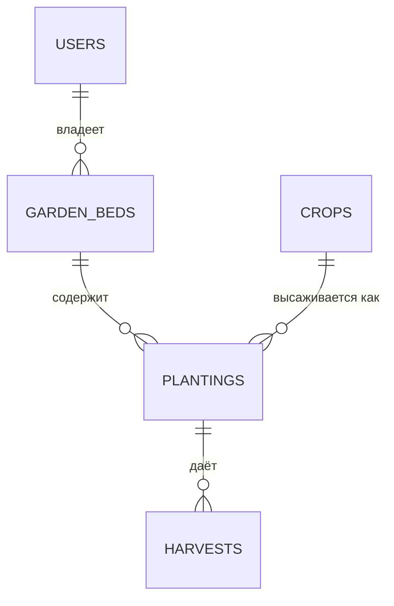

# Огород — REST API для учёта грядок, посадок и урожая (с аутентификацией и авторизацией)

Учебный проект (Spring Boot + Spring Data JPA + PostgreSQL). Приложение помогает садоводу вести учёт:
какие у него грядки, что и в каком количестве на них посажено и сколько урожая собрано.
Кроме обычного CRUD, оно реализует бизнес-правила: нельзя посадить больше растений, чем помещается на грядке,
нельзя собирать урожай с не растущей посадки, нельзя передать грядку с растущими посадками и т. д.

## Предметная модель



| Сущность | Таблица | Назначение | Основные поля |
|---|---|---|---|
| Пользователь | `users` | владелец грядок и учётная запись для входа | имя, email (уникальный, он же логин), хэш пароля BCrypt, роль, статус |
| Грядка | `garden_beds` | участок земли | площадь (м²), владелец, доступность |
| Культура | `crops` | справочник растений | название (уникальное), сезон, минимальная площадь на растение (м²) |
| Посадка | `plantings` | культура на грядке | грядка, культура, количество растений, статус (`PLANNED` → `GROWING` → `HARVESTED`), дата посадки |
| Сбор урожая | `harvests` | факт сбора | посадка, дата (ставит сервер), масса (кг) |

**Целостность на уровне БД:** внешние ключи с `ON DELETE CASCADE` (удаление владельца/грядки/культуры/посадки
не оставляет висячих ссылок), `UNIQUE` (email, название культуры), `CHECK` (площадь, масса, количество > 0;
допустимые значения сезона и статуса), `NOT NULL`.

## Бизнес-операции

| Операция | Запрос | Затрагивает | Когда недопустима (409) |
|---|---|---|---|
| Посадить культуру на грядку | `POST /api/garden-beds/{id}/plant` `{cropId, plantCount}` | грядка, культура → новая посадка | грядка недоступна; не хватает свободной площади |
| Собрать урожай | `POST /api/plantings/{id}/harvest` `{mass, finalHarvest}` | посадка → новый сбор, статус посадки | посадка не в статусе `GROWING`. При `finalHarvest=true` посадка закрывается и освобождает площадь |
| Передать грядку | `POST /api/garden-beds/{id}/transfer` `{newOwnerId}` | грядка, пользователь, посадки | тот же владелец; на грядке есть растущие посадки |
| Перенести посадку | `POST /api/plantings/{id}/move` `{targetBedId}` | посадка, две грядки | посадка уже собрана; целевая грядка недоступна или мала; та же грядка |
| Закрыть сезон на грядке | `POST /api/garden-beds/{id}/close-season` | грядка, посадки, сборы | нет растущих посадок; хотя бы у одной не было сборов (тогда не закрывается ни одна) |

Результат зависит от текущего состояния данных (занятая площадь, статусы, наличие сборов). Каждая операция
выполняется в одной транзакции и либо применяется целиком, либо откатывается. Корректность при параллельных
запросах обеспечивают блокировка строки грядки (`SELECT ... FOR UPDATE`) и версия посадки (`@Version`).

Коды ответов: `200` чтение/обновление, `201` создание, `204` удаление, `400` некорректные данные,
`401` не аутентифицирован, `403` нет прав, `404` не найдено, `409` операция недопустима в текущем состоянии.

## CRUD

Для каждой сущности: `GET /api/{resources}`, `GET /api/{resources}/{id}`, `POST`, `PATCH /{id}`, `DELETE /{id}`,
где ресурсы — `users`, `garden-beds`, `crops`, `plantings`, `harvests`.


## Безопасность (Spring Security)

**Аутентификация (JWT).** При входе или регистрации клиент получает пару токенов `{accessToken, refreshToken}`.
Оба — подписанные JWT (HS256). Access (по умолчанию 15 минут) передаётся в каждом запросе к защищённым адресам:
`Authorization: Bearer <accessToken>`. Refresh (по умолчанию 7 дней) нужен только для получения новой пары и передаётся
в теле запроса `POST /auth/refresh`. Сессий HTTP нет (`STATELESS`), пароли хранятся только как BCrypt-хэши (`PasswordEncoder`).
Заблокированный пользователь (`status = BLOCKED`) не может ни войти, ни обновить пару, а выданный ему access перестаёт
приниматься сразу (учётная запись и роль проверяются по БД на каждом запросе).

| Запрос | Что делает | Успех |
|---|---|---|
| `POST /auth/login` `{email, password, deviceId?}` | проверяет логин и пароль, выдаёт пару | `200` |
| `POST /auth/register` `{name, email, password, deviceId?}` | создаёт учётную запись и сразу выдаёт пару | `201` |
| `POST /auth/refresh` `{refreshToken}` | обменивает действующий refresh на новую пару (access не нужен, пароль не нужен) | `200` |
| `GET /auth/me` | кто я (защищённый адрес, нужен access) | `200` |

Ответ первых трёх запросов: `{"accessToken": "<JWT>", "refreshToken": "<JWT>"}`. `deviceId` — необязательная метка клиента
(до 128 символов), подлинность устройства она не подтверждает.

**Токены.** В обоих: `iss`, `sub` (email), `iat`, `exp`, `jti` (новый при каждой выдаче) и `type` (`access` или `refresh`).
У access ещё `auth` — роли на момент выдачи (для решений о доступе они не используются: роль берётся из БД,
поэтому её смена или блокировка действуют сразу). Проверка включает подпись, срок, издателя, алгоритм, обязательные
claims и `type`: access-фильтр принимает только access, обработчик обновления — только refresh. Ключ подписи
(`JWT_SECRET`, не менее 32 случайных байт в Base64) хранится в `.env`, в коде и в git его нет. Сроки задаются в
`application.yml`: `jwt.accessExpiration`, `jwt.refreshExpiration` (миллисекунды).

**Сессии (таблица `user_sessions`).** Одна запись — одна выданная пара: владелец (`username` = email), `deviceId`, оба токена,
их сроки (совпадают с `exp` до секунды) и статус:

| Статус | Значение |
|---|---|
| `ACTIVE` | refresh ещё не использован и не отозван |
| `USED` | refresh успешно обменян на новую пару |
| `REVOKED` | refresh отозван |

**Обновление пары** (`TokenPairService.refresh`, одна транзакция `@Transactional`): проверить refresh как JWT с `type = refresh` →
найти сессию (строка блокируется `SELECT ... FOR UPDATE`) → проверить, что `sub` совпадает с владельцем записи, пользователь
существует и активен, статус `ACTIVE`, `refreshTokenExpiry > now` → старую сессию перевести в `USED` → создать новую пару и
новую сессию `ACTIVE` (тот же пользователь и `deviceId`) → зафиксировать транзакцию. Если новую пару сохранить не удалось,
транзакция откатывается и старая сессия остаётся `ACTIVE`. Блокировка строки гарантирует, что при двух одновременных
запросах с одним refresh обмен выполнит только один. Повторное предъявление ещё не истёкшего refresh со статусом `USED`
переводит запись в `REVOKED` и возвращает `401` без новой пары; это изменение сохраняется, несмотря на отказ
(`noRollbackFor = UnauthorizedException`). Отзыв всей цепочки обновлений и немедленный отзыв access не выполняются.

**Регистрация.** Проверяется уникальность email и надёжность пароля (10–64 символа, строчная и заглавная буквы, цифра,
спецсимвол, без пробелов, без частей email и слов вроде `password`). Роль и статус из запроса игнорируются: новый
пользователь всегда `GARDENER` + `ACTIVE`. Создание пользователя и сессии — одна транзакция: если сессию сохранить не
удалось, регистрация откатывается и клиент не получает успешный ответ с токенами.

**CSRF.** Отключена осознанно: CSRF-атака опирается на то, что браузер сам прикладывает к запросу учётные данные
(cookie, сессию, Basic). Access-токен браузер сам не подставляет — его в заголовок `Authorization` кладёт код клиента, поэтому
чужой сайт не может отправить запрос от имени пользователя. Cookie с токенами не используются.

**Роли**

| Роль | Что может |
|---|---|
| `GARDENER` (садовод) | читает справочник культур; создаёт и меняет только **свои** грядки, посадки, сборы; выполняет бизнес-операции только над своими грядками и посадками; правит свой профиль (без роли и статуса) |
| `AGRONOMIST` (агроном) | всё, что садовод, плюс ведёт справочник культур (создание, изменение, удаление) |
| `ADMIN` (администратор) | всё: любые данные и бизнес-операции, управление пользователями (роль, статус, удаление) |

**Контекст операции.** Права зависят не только от роли, но и от владельца объекта: «моя ли это грядка/посадка».
Передали грядку другому — прав на неё больше нет. Перенести посадку можно только на свою грядку. Списки
(`GET /api/garden-beds`, `/plantings`, `/harvests`) садовод видит только в части своих данных.

**Где настроено.** `SecurityFilterChain` (`security/SecurityConfig`) — грубые правила по URL; `@PreAuthorize` на методах
контроллеров — точные правила с проверкой владельца (`security/AccessService`).

**Отказы** различаются кодами и сообщениями, подробности не раскрываются:

| Код | Когда |
|---|---|
| `401` | нет access-токена или он недействителен (подпись, срок, тип); неверный логин/пароль или заблокированная учётная запись при входе; недействительный, использованный или отозванный refresh (сообщения не раскрывают причину) |
| `403` | токен действителен, но прав недостаточно |
| `409` | прав достаточно, но бизнес-ограничение не позволяет операцию (нет места, неверный статус и т. п.; нельзя удалить/заблокировать/понизить последнего активного администратора) |
| `400` / `404` | некорректные данные (в т. ч. пустые обязательные поля входа и обновления) / объект не найден |

## Демонстрационные учётные записи (после `db/03_test_data.sql`)

| Роль | Email | Пароль |
|---|---|---|
| Садовод (грядки 1, 2) | `timofey@example.com` | `Timofey#2026` |
| Садовод (грядка 3) | `anna@example.com` | `Anna#2026pw` |
| Администратор | `admin@example.com` | `Admin#2026pw` |
| Агроном | `agro@example.com` | `Agro#2026pw` |
| Заблокирован | `blocked@example.com` | `Blocked#2026` (войти нельзя) |

Войти этими учётками: `POST /auth/login` `{"email": "...", "password": "..."}`.
Пароли демонстрационные, в реальной системе такие пароли нельзя публиковать.

## Запуск

**Зависимости в `pom.xml`** (кроме веб-стартера, JPA, драйвера PostgreSQL и Spring Security из прошлых заданий добавляется JWT,
все три артефакта одной версии):
```xml
<dependency>
    <groupId>io.jsonwebtoken</groupId>
    <artifactId>jjwt-api</artifactId>
    <version>0.13.0</version>
</dependency>
<dependency>
    <groupId>io.jsonwebtoken</groupId>
    <artifactId>jjwt-impl</artifactId>
    <version>0.13.0</version>
    <scope>runtime</scope>
</dependency>
<dependency>
    <groupId>io.jsonwebtoken</groupId>
    <artifactId>jjwt-jackson</artifactId>
    <version>0.13.0</version>
    <scope>runtime</scope>
</dependency>
```

1. **PostgreSQL.** Установите (https://www.postgresql.org/download/) и выполните скрипты из папки `db/`
   под пользователем `postgres`:
   ```bash
   sudo -u postgres psql -f db/01_create_db_and_user.sql          # БД garden и пользователь garden_app
   sudo -u postgres psql -d garden -f db/02_schema.sql             # таблицы, ограничения, права
   sudo -u postgres psql -d garden -f db/03_test_data.sql          # тестовые данные и демо-учётки
   sudo -u postgres psql -d garden -f db/04_user_sessions.sql      # таблица сессий (JWT), права только SELECT/INSERT/UPDATE
   ```
   (в pgAdmin то же самое: Query Tool → открыть файл → выполнить; шаг 1 — в БД `postgres`, шаги 2–4 — в БД `garden`).
   Перед шагом 1 замените пароль `change_me_strong_password` на свой. Если БД с прошлых заданий уже есть, достаточно выполнить
   только шаг 4 (остальные данные он не трогает).
2. **Секреты.** Скопируйте `.env.example` в `.env`, впишите тот же пароль БД и свой ключ подписи JWT в `JWT_SECRET`
   (команда генерации указана в `.env.example`, например `openssl rand -base64 32`). Файл `.env` в git не попадает.
3. **Запуск приложения:** `mvn spring-boot:run` или запуск `DemoApplication` из IDE (сервер на `localhost:8080`).
4. **Проверка сценария** (Postman или любой HTTP-клиент; свежие данные — `db/03_test_data.sql`, он же очищает сессии):
   1. `POST /auth/login` с `deviceId` (например, `postman-demo`) → `200`, пара токенов. В БД одна сессия `ACTIVE`.
   2. С полученным access вызвать защищённый адрес (например, `GET /auth/me` или `GET /api/garden-beds`,
      заголовок `Authorization: Bearer <accessToken>`) → доступ есть.
   3. `POST /auth/refresh` `{"refreshToken": "<текущий refresh>"}` → `200`, новая пара (строки токенов другие).
      В БД первая сессия `USED`, новая `ACTIVE`.
   4. Повторно отправить старый refresh → `401`, новая пара не выдаётся.
   5. В БД первая сессия `REVOKED`, вторая `ACTIVE`, лишних строк нет.

   Состояние сессий смотрите запросами из `db/check_sessions.sql`.

## Безопасность данных

* Пароли пользователей — только BCrypt-хэши, в ответах API паролей и хэшей нет.
* Пароль БД и ключ подписи JWT не хранятся в коде: берутся из `.env` / переменных окружения.
* Приложение подключается пользователем `garden_app` с минимальными правами: только `SELECT/INSERT/UPDATE/DELETE`
  на таблицы и использование их последовательностей; на таблицу сессий `user_sessions` — только `SELECT/INSERT/UPDATE`. Создавать, изменять и удалять таблицы он не может,
  структуру БД ведёт администратор скриптами из `db/`.
* Все запросы к БД параметризованы (Spring Data / JPQL с именованными параметрами) — защита от SQL-инъекций.
* Ошибки БД клиенту не показываются: он получает короткое сообщение без внутренних деталей.
* Токены и пароли в журнал не пишутся; причина отказа `401` клиенту не раскрывается.
