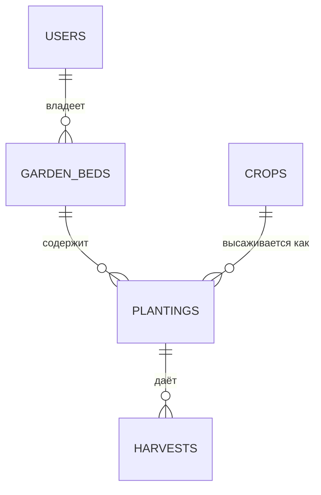

# Огород — REST API для учёта грядок, посадок и урожая (с аутентификацией и авторизацией)

Учебный проект (Spring Boot + Spring Data JPA + PostgreSQL). Приложение помогает садоводу вести учёт:
какие у него грядки, что и в каком количестве на них посажено и сколько урожая собрано.
Кроме обычного CRUD, оно реализует бизнес-правила: нельзя посадить больше растений, чем помещается на грядке,
нельзя собирать урожай с не растущей посадки, нельзя передать грядку с растущими посадками и т. д.

## Предметная модель



| Сущность | Таблица | Назначение | Основные поля |
|---|---|---|---|
| Пользователь | `users` | владелец грядок и учётная запись для входа | имя, email (уникальный, он же логин), хэш пароля BCrypt, роль, статус |
| Грядка | `garden_beds` | участок земли | площадь (м²), владелец, доступность |
| Культура | `crops` | справочник растений | название (уникальное), сезон, минимальная площадь на растение (м²) |
| Посадка | `plantings` | культура на грядке | грядка, культура, количество растений, статус (`PLANNED` → `GROWING` → `HARVESTED`), дата посадки |
| Сбор урожая | `harvests` | факт сбора | посадка, дата (ставит сервер), масса (кг) |

**Целостность на уровне БД:** внешние ключи с `ON DELETE CASCADE` (удаление владельца/грядки/культуры/посадки
не оставляет висячих ссылок), `UNIQUE` (email, название культуры), `CHECK` (площадь, масса, количество > 0;
допустимые значения сезона и статуса), `NOT NULL`.

## Бизнес-операции

| Операция | Запрос | Затрагивает | Когда недопустима (409) |
|---|---|---|---|
| Посадить культуру на грядку | `POST /api/garden-beds/{id}/plant` `{cropId, plantCount}` | грядка, культура → новая посадка | грядка недоступна; не хватает свободной площади |
| Собрать урожай | `POST /api/plantings/{id}/harvest` `{mass, finalHarvest}` | посадка → новый сбор, статус посадки | посадка не в статусе `GROWING`. При `finalHarvest=true` посадка закрывается и освобождает площадь |
| Передать грядку | `POST /api/garden-beds/{id}/transfer` `{newOwnerId}` | грядка, пользователь, посадки | тот же владелец; на грядке есть растущие посадки |
| Перенести посадку | `POST /api/plantings/{id}/move` `{targetBedId}` | посадка, две грядки | посадка уже собрана; целевая грядка недоступна или мала; та же грядка |
| Закрыть сезон на грядке | `POST /api/garden-beds/{id}/close-season` | грядка, посадки, сборы | нет растущих посадок; хотя бы у одной не было сборов (тогда не закрывается ни одна) |

Результат зависит от текущего состояния данных (занятая площадь, статусы, наличие сборов). Каждая операция
выполняется в одной транзакции и либо применяется целиком, либо откатывается. Корректность при параллельных
запросах обеспечивают блокировка строки грядки (`SELECT ... FOR UPDATE`) и версия посадки (`@Version`).

Коды ответов: `200` чтение/обновление, `201` создание, `204` удаление, `400` некорректные данные,
`401` не аутентифицирован, `403` нет прав, `404` не найдено, `409` операция недопустима в текущем состоянии.

## CRUD

Для каждой сущности: `GET /api/{resources}`, `GET /api/{resources}/{id}`, `POST`, `PATCH /{id}`, `DELETE /{id}`,
где ресурсы — `users`, `garden-beds`, `crops`, `plantings`, `harvests`.


## Безопасность (Spring Security)

**Аутентификация.** HTTP Basic: логин — email, пароль — из регистрации. Сессий нет (`STATELESS`): каждый запрос
проверяется заголовком `Authorization`. Пароли хранятся только как BCrypt-хэши (`PasswordEncoder`).
Заблокированный пользователь (`status = BLOCKED`) войти не может.

**CSRF.** Включена для всех запросов, изменяющих данные (`POST`, `PATCH`, `DELETE`). Получение токена —
`GET /api/csrf` (ответ `{"headerName": "X-CSRF-TOKEN", "token": "..."}`, одновременно ставится cookie `XSRF-TOKEN`).
Токен передаётся в заголовке `X-CSRF-TOKEN`. Без него запрос получает `403`.

**Регистрация.** `POST /api/auth/register` `{name, email, password}` (нужен CSRF-токен, вход не нужен).
Проверяется уникальность email и надёжность пароля (10–64 символа, строчная и заглавная буквы, цифра,
спецсимвол, без пробелов, без частей email и слов вроде `password`). Роль и статус из запроса игнорируются:
новый пользователь всегда `GARDENER` + `ACTIVE`. Кто я: `GET /api/auth/me`.

**Роли**

| Роль | Что может |
|---|---|
| `GARDENER` (садовод) | читает справочник культур; создаёт и меняет только **свои** грядки, посадки, сборы; выполняет бизнес-операции только над своими грядками и посадками; правит свой профиль (без роли и статуса) |
| `AGRONOMIST` (агроном) | всё, что садовод, плюс ведёт справочник культур (создание, изменение, удаление) |
| `ADMIN` (администратор) | всё: любые данные и бизнес-операции, управление пользователями (роль, статус, удаление) |

**Контекст операции.** Права зависят не только от роли, но и от владельца объекта: «моя ли это грядка/посадка».
Передали грядку другому — прав на неё больше нет. Перенести посадку можно только на свою грядку. Списки
(`GET /api/garden-beds`, `/plantings`, `/harvests`) садовод видит только в части своих данных.

**Где настроено.** `SecurityFilterChain` (`security/SecurityConfig`) — грубые правила по URL; `@PreAuthorize` на методах
контроллеров — точные правила с проверкой владельца (`security/AccessService`).

**Отказы** различаются кодами и сообщениями, подробности не раскрываются:

| Код | Когда |
|---|---|
| `401` | нет логина/пароля, они неверны или учётная запись заблокирована (сообщение одинаковое для всех случаев) |
| `403` | вход выполнен, но прав недостаточно или нет верного CSRF-токена |
| `409` | прав достаточно, но бизнес-ограничение не позволяет операцию (нет места, неверный статус и т. п.; нельзя удалить/заблокировать/понизить последнего активного администратора) |
| `400` / `404` | некорректные данные / объект не найден |

## Демонстрационные учётные записи (после `db/03_test_data.sql`)

| Роль | Email | Пароль |
|---|---|---|
| Садовод (грядки 1, 2) | `timofey@example.com` | `Timofey#2026` |
| Садовод (грядка 3) | `anna@example.com` | `Anna#2026pw` |
| Администратор | `admin@example.com` | `Admin#2026pw` |
| Агроном | `agro@example.com` | `Agro#2026pw` |
| Заблокирован | `blocked@example.com` | `Blocked#2026` (войти нельзя) |

Пароли демонстрационные, в реальной системе такие пароли нельзя публиковать.

## Запуск

**Зависимости в `pom.xml`** (кроме веб-стартера, JPA и драйвера PostgreSQL из прошлого задания добавляется Spring Security):
```xml
<dependency>
    <groupId>org.springframework.boot</groupId>
    <artifactId>spring-boot-starter-security</artifactId>
</dependency>
```

1. **PostgreSQL.** Установите (https://www.postgresql.org/download/) и выполните скрипты из папки `db/`
   под пользователем `postgres`:
   ```bash
   sudo -u postgres psql -f db/01_create_db_and_user.sql          # БД garden и пользователь garden_app
   sudo -u postgres psql -d garden -f db/02_schema.sql             # таблицы, ограничения, права
   sudo -u postgres psql -d garden -f db/03_test_data.sql          # тестовые данные и демо-учётки
   ```
   (в pgAdmin то же самое: Query Tool → открыть файл → выполнить; шаг 1 — в БД `postgres`, шаги 2–3 — в БД `garden`).
   Перед шагом 1 замените пароль `change_me_strong_password` на свой.
2. **Секреты.** Скопируйте `.env.example` в `.env` и впишите тот же пароль. Файл `.env` в git не попадает.
3. **Запуск приложения:** `mvn spring-boot:run` или запуск `DemoApplication` из IDE (сервер на `localhost:8080`).
4. **Проверка:** импортируйте в Postman `garden_lab4.postman_collection.json` и запустите коллекцию
   (Run collection). Перед каждым прогоном выполняйте `db/03_test_data.sql` (свежие данные и учётки).

## Безопасность данных

* Пароли пользователей — только BCrypt-хэши, в ответах API паролей и хэшей нет.
* Пароль БД не хранится в коде: берётся из `.env` / переменных окружения.
* Приложение подключается пользователем `garden_app` с минимальными правами: только `SELECT/INSERT/UPDATE/DELETE`
  на таблицы и использование их последовательностей. Создавать, изменять и удалять таблицы он не может,
  структуру БД ведёт администратор скриптами из `db/`.
* Все запросы к БД параметризованы (Spring Data / JPQL с именованными параметрами) — защита от SQL-инъекций.
* Ошибки БД клиенту не показываются: он получает короткое сообщение без внутренних деталей.
