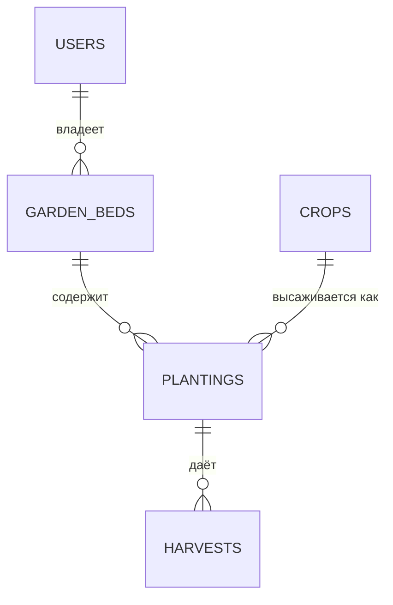

# Огород — REST API для учёта грядок, посадок и урожая

Учебный проект (Spring Boot + Spring Data JPA + PostgreSQL). Приложение помогает садоводу вести учёт:
какие у него грядки, что и в каком количестве на них посажено и сколько урожая собрано.
Кроме обычного CRUD, оно реализует бизнес-правила: нельзя посадить больше растений, чем помещается на грядке,
нельзя собирать урожай с не растущей посадки, нельзя передать грядку с растущими посадками и т. д.

## Предметная модель



| Сущность | Таблица | Назначение | Основные поля |
|---|---|---|---|
| Пользователь | `users` | владелец грядок | имя, email (уникальный) |
| Грядка | `garden_beds` | участок земли | площадь (м²), владелец, доступность |
| Культура | `crops` | справочник растений | название (уникальное), сезон, минимальная площадь на растение (м²) |
| Посадка | `plantings` | культура на грядке | грядка, культура, количество растений, статус (`PLANNED` → `GROWING` → `HARVESTED`), дата посадки |
| Сбор урожая | `harvests` | факт сбора | посадка, дата (ставит сервер), масса (кг) |

**Целостность на уровне БД:** внешние ключи с `ON DELETE CASCADE` (удаление владельца/грядки/культуры/посадки
не оставляет висячих ссылок), `UNIQUE` (email, название культуры), `CHECK` (площадь, масса, количество > 0;
допустимые значения сезона и статуса), `NOT NULL`.

## Бизнес-операции

| Операция | Запрос | Затрагивает | Когда недопустима (409) |
|---|---|---|---|
| Посадить культуру на грядку | `POST /api/garden-beds/{id}/plant` `{cropId, plantCount}` | грядка, культура → новая посадка | грядка недоступна; не хватает свободной площади |
| Собрать урожай | `POST /api/plantings/{id}/harvest` `{mass, finalHarvest}` | посадка → новый сбор, статус посадки | посадка не в статусе `GROWING`. При `finalHarvest=true` посадка закрывается и освобождает площадь |
| Передать грядку | `POST /api/garden-beds/{id}/transfer` `{newOwnerId}` | грядка, пользователь, посадки | тот же владелец; на грядке есть растущие посадки |
| Перенести посадку | `POST /api/plantings/{id}/move` `{targetBedId}` | посадка, две грядки | посадка уже собрана; целевая грядка недоступна или мала; та же грядка |
| Закрыть сезон на грядке | `POST /api/garden-beds/{id}/close-season` | грядка, посадки, сборы | нет растущих посадок; хотя бы у одной не было сборов (тогда не закрывается ни одна) |

Результат зависит от текущего состояния данных (занятая площадь, статусы, наличие сборов). Каждая операция
выполняется в одной транзакции и либо применяется целиком, либо откатывается. Корректность при параллельных
запросах обеспечивают блокировка строки грядки (`SELECT ... FOR UPDATE`) и версия посадки (`@Version`).

Коды ответов: `200` чтение/обновление, `201` создание, `204` удаление, `400` некорректные данные,
`404` не найдено, `409` операция недопустима в текущем состоянии.

## CRUD

Для каждой сущности: `GET /api/{resources}`, `GET /api/{resources}/{id}`, `POST`, `PATCH /{id}`, `DELETE /{id}`,
где ресурсы — `users`, `garden-beds`, `crops`, `plantings`, `harvests`.

## Запуск

1. **PostgreSQL.** Установите (https://www.postgresql.org/download/) и выполните скрипты из папки `db/`
   под пользователем `postgres`:
   ```bash
   sudo -u postgres psql -f db/01_create_db_and_user.sql          # БД garden и пользователь garden_app
   sudo -u postgres psql -d garden -f db/02_schema.sql             # таблицы, ограничения, права
   sudo -u postgres psql -d garden -f db/03_test_data.sql          # тестовые данные
   ```
   (в pgAdmin то же самое: Query Tool → открыть файл → выполнить; шаг 1 — в БД `postgres`, шаги 2–3 — в БД `garden`).
   Перед шагом 1 замените пароль `change_me_strong_password` на свой.
2. **Секреты.** Скопируйте `.env.example` в `.env` и впишите тот же пароль. Файл `.env` в git не попадает.
3. **Запуск приложения:** `mvn spring-boot:run` или запуск `DemoApplication` из IDE (сервер на `localhost:8080`).
4. **Проверка:** импортируйте в Postman `garden_lab3.postman_collection.json` и запустите коллекцию
   (Run collection). Часть B рассчитана на свежие тестовые данные — при повторном прогоне выполните `03_test_data.sql` заново.

## Безопасность данных

* Пароль БД не хранится в коде: берётся из `.env` / переменных окружения.
* Приложение подключается пользователем `garden_app` с минимальными правами: только `SELECT/INSERT/UPDATE/DELETE`
  на таблицы и использование их последовательностей. Создавать, изменять и удалять таблицы он не может,
  структуру БД ведёт администратор скриптами из `db/`.
* Все запросы к БД параметризованы (Spring Data / JPQL с именованными параметрами) — защита от SQL-инъекций.
* Ошибки БД клиенту не показываются: он получает короткое сообщение без внутренних деталей.
